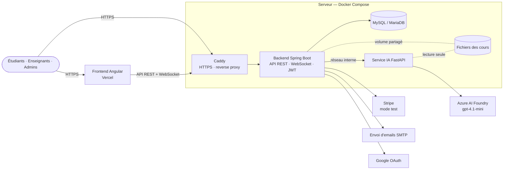

# LMS — Plateforme d'apprentissage en ligne avec IA

Projet de fin d'études : un LMS complet (cours, évaluations, paiement, visio) dont les quiz, les TP,
les corrections et l'assistant de cours sont générés par l'IA (Azure AI Foundry · gpt-4.1-mini).

## Organisation du dépôt (monorepo)

```
.
├── backend/    API REST Spring Boot 4 (Java 17) · sécurité JWT · MySQL/MariaDB · WebSocket · tâches planifiées
├── frontend/   Application Angular 22 + CoreUI (espaces étudiant, enseignant, admin, super admin)
├── ai/         Service IA FastAPI (Python 3.12) · génération et correction · analyse PDF/vidéo/audio
├── deploy/     docker-compose de production, Caddy (HTTPS), supervision Prometheus/Grafana, test de charge k6
└── .github/    CI/CD GitHub Actions des 3 composants + Dependabot
```

Chaque dossier a son propre `README.md` (installation, variables d'environnement, tests).

## Architecture



Règles de sécurité de l'architecture :

- le navigateur ne parle **qu'au backend** ; le service IA et la base ne sont jamais exposés sur Internet ;
- seul le service IA appelle Azure AI Foundry ; les clés restent sur le serveur (fichier `.env`, jamais dans Git) ;
- le backend contrôle l'accès à tout : jeton JWT, rôle, inscription au cours, propriétaire du contenu.

## Fonctionnalités

| Domaine | Contenu |
|---|---|
| Comptes et rôles | Étudiant, enseignant, admin (validé par le super admin), super admin unique ; vérification de l'email, mot de passe oublié, connexion Google |
| Cours | Chapitres et leçons : PDF (lecteur intégré), vidéo, audio, YouTube, liens, texte ; progression réelle par ressource |
| IA | Génération de quiz et de TP par niveau (débutant, intermédiaire, avancé) à partir du contenu du cours, correction automatique, assistant de cours |
| Évaluations | Date limite, chrono côté serveur, envoi automatique à la fin du temps, sujets importés en fichier et notés sur 20 |
| Paiement | Stripe Checkout (mode test), webhook signé et idempotent, portefeuilles enseignants simulés |
| Communication | Messagerie, notifications en temps réel, réunions en visio (WebRTC), enregistrements, réclamations |
| Pilotage | Tableaux de bord avec graphiques, suivi pédagogique, supervision et journaux pour l'administration |

## Lancer le projet en local

| Composant | Commande | Adresse |
|---|---|---|
| Base | XAMPP (MariaDB) ou `docker run -e MYSQL_ROOT_PASSWORD=… -p 3306:3306 mysql:8.4` | `localhost:3306` |
| Backend | `cd backend` · copier `.env.example` en `.env` · `./mvnw spring-boot:run` | http://localhost:8090 |
| Service IA | `cd ai` · copier `.env.example` en `.env` · `pip install -r requirements.txt` · `uvicorn main:app --port 8000` | http://localhost:8000 |
| Frontend | `cd frontend` · `npm ci` · `npm start` | http://localhost:4200 |

Ou tout d'un coup avec Docker : `cd deploy` puis
`docker compose -f docker-compose.yml -f docker-compose.build.yml up -d --build` (voir `deploy/README.md`).

## Qualité, sécurité et CI/CD

Chaque pull request vers `main` lance uniquement les pipelines du composant modifié :

| Pipeline | Contenu |
|---|---|
| CI | Backend : Maven + JUnit sur une vraie base MySQL, couverture JaCoCo · Frontend : tests Vitest + build de production · IA : Ruff + pytest |
| Sécurité | CodeQL, Gitleaks (secrets), Trivy et audits de dépendances, Dependency Review, Dependabot |
| CD | Image Docker → scan Trivy → GitHub Container Registry → staging → production après approbation, retour arrière automatique |

## Déploiement

- **Frontend** : Vercel (branche `main`, dossier `frontend`, variable `API_URL`).
- **Backend, IA et base** : une VM Linux avec Docker Compose (`deploy/`), HTTPS automatique par Caddy.

Procédure détaillée, variables d'environnement et options d'hébergement : [`deploy/README.md`](deploy/README.md).
