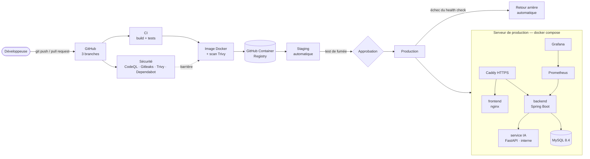

# LMS — CI/CD et déploiement

Ce dossier contient tout ce qu'il faut pour mettre le LMS en ligne (frontend Angular, backend Spring Boot,
service IA FastAPI, base MySQL) sur **n'importe quel hébergeur** : un serveur avec Docker (VPS, VM Azure…),
Render, Azure App Service ou Vercel pour le frontend.

## 1. Architecture retenue



### Ce qui a été retenu des architectures étudiées, et pourquoi

| Élément | Décision | Raison |
|---|---|---|
| GitHub Actions (CI + CD) | ✅ retenu | Gratuit pour un dépôt public, intégré au dépôt, aucun serveur à gérer |
| Build + tests automatiques (Maven/JUnit, Vitest, pytest) | ✅ retenu | Aucune version cassée n'est déployée |
| Barrières de sécurité (CodeQL, Gitleaks, Trivy, Dependabot, Dependency Review) | ✅ retenu | DevSecOps : failles, secrets et dépendances vulnérables bloqués avant la production |
| Images Docker + registre | ✅ retenu (GHCR) | Même image sur tous les hébergeurs. GHCR plutôt qu'Azure Container Registry : gratuit et lié au compte GitHub |
| Staging puis production avec approbation | ✅ retenu (GitHub Environments) | Tester avant la mise en ligne, validation humaine pour la production |
| Test de fumée + retour arrière | ✅ retenu | Un service qui ne démarre pas revient seul à la version précédente |
| Supervision Prometheus + Grafana | ✅ retenu (option) | Temps de réponse, erreurs, mémoire et base de données en direct |
| Test de charge k6 | ✅ retenu (manuel) | Mesurer la capacité à supporter plusieurs étudiants en même temps |
| HTTPS automatique | ✅ retenu (Caddy) | Certificats Let's Encrypt obtenus et renouvelés sans intervention |
| SonarQube | ✅ retenu (SonarCloud, facultatif) | Gratuit pour un dépôt public, aucun serveur SonarQube à maintenir |
| Kubernetes (AKS), Helm, ArgoCD | ⏳ phase 2 | Coût et complexité disproportionnés pour un LMS de PFE ; `docker compose` couvre le besoin. Les images actuelles sont déjà prêtes pour Kubernetes |
| Terraform, Vault, OPA, Falco, Sentinel, OWASP ZAP | ⏳ phase 2 | Utiles à grande échelle ; les secrets sont gérés par GitHub Environments et le fichier `.env` du serveur |

## 2. Les pipelines

Chaque composant vit sur sa branche et possède ses propres workflows (`.github/workflows/`).

| Workflow | Branche | Déclenchement | Rôle | Bloquant |
|---|---|---|---|---|
| **Backend CI** | `LMS-Backend-Spring` | push, pull request | Maven + JUnit sur une vraie base MySQL 8.4, couverture JaCoCo, SonarCloud | ✅ |
| **Frontend CI** | `LMS-Frontend` | push, pull request | Tests Vitest (Chromium), build de production avec budgets de taille | ✅ |
| **AI CI** | `LMS-AI` | push, pull request | Ruff + pytest : validation JSON des QCM, correction, API (sans appeler Azure) | ✅ |
| **… Security** (×3) | les 3 | push, PR, chaque lundi | CodeQL, Gitleaks, Trivy / npm audit / pip-audit, Dependency Review | ✅ failles critiques, secrets |
| **… CD** (×3) | les 3 | push, manuel | Image Docker → Trivy → GHCR → staging → production (approbation) | ✅ faille critique dans l'image |
| **Déploiement complet** | `LMS-Backend-Spring` | manuel | Copie `docker-compose.yml` sur le serveur et démarre toute la plateforme | — |
| **Test de charge (k6)** | `LMS-Backend-Spring` | manuel | N utilisateurs simultanés : p95, taux d'erreur | seuils k6 |
| **Dependabot** | les 3 | chaque lundi | Pull requests de mise à jour (Maven, npm, pip, Docker, Actions) | — |

Les résultats de sécurité apparaissent dans l'onglet **Security** du dépôt, les rapports de tests et de
couverture dans les **artefacts** de chaque exécution.

## 3. Mise en place (une seule fois)

### 3.1 Réglages GitHub

1. **Settings → Environments** : créer `staging` et `production`.
   Sur `production`, cocher **Required reviewers** (vous-même) : chaque mise en production attend votre clic.
2. **Settings → Branches → Branch protection** sur les 3 branches : exiger une pull request et les checks
   *CI* et *Security* avant la fusion.
3. **Settings → Code security** : activer *Dependency graph*, *Dependabot alerts* et *Code scanning*.
4. Après la première exécution des CD, rendre les 3 paquets publics (**Packages → lms-… → Package settings →
   Change visibility**) **ou** créer un jeton `read:packages` et l'ajouter comme secret `GHCR_READ_TOKEN`.

### 3.2 Choisir l'hébergement

#### Option A — Un serveur avec Docker (recommandée : VPS, VM Azure Students, serveur de l'école)

```bash
# Sur le serveur (Ubuntu) : installer Docker
curl -fsSL https://get.docker.com | sh
sudo mkdir -p /opt/lms && sudo chown $USER /opt/lms
# Copier deploy/docker-compose.yml et deploy/.env.example dans /opt/lms
cd /opt/lms && cp .env.example .env && nano .env      # remplir les secrets
openssl rand -base64 64                               # pour JWT_SECRET
docker compose up -d                                  # + --profile https / monitoring si besoin
```

Puis dans GitHub (environnements `staging` / `production`) :

| Nom | Type | Exemple |
|---|---|---|
| `DEPLOY_SSH_HOST` | secret | `203.0.113.10` |
| `DEPLOY_SSH_USER` | secret | `ubuntu` |
| `DEPLOY_SSH_KEY` | secret | clé privée SSH (la clé publique dans `~/.ssh/authorized_keys` du serveur) |
| `DEPLOY_PATH` | variable | `/opt/lms` |
| `HEALTH_URL_BACKEND` | variable | `https://api.mon-lms.com/readyz` |
| `HEALTH_URL_FRONTEND` | variable | `https://app.mon-lms.com/healthz` |

Le workflow **Déploiement complet** peut aussi copier les fichiers et démarrer la plateforme à votre place.

**HTTPS** : faire pointer deux noms de domaine vers le serveur, remplir `APP_DOMAIN`, `API_DOMAIN`, `ACME_EMAIL`
dans `.env`, puis `docker compose --profile https up -d`.

#### Option B — Render

1. Créer 3 *Web Services* « Deploy an existing image » : `ghcr.io/riahichaima/lms-backend:latest`,
   `…/lms-ai:latest`, `…/lms-frontend:latest` (+ une base MySQL externe, ex. Aiven ou Azure Database for MySQL).
2. Variables d'environnement : celles de `deploy/.env.example` (backend : `DB_URL`, `JWT_SECRET`… ;
   frontend : `API_URL` ; IA : `AZURE_OPENAI_*`). Health check : `/readyz`, `/healthz`, `/api/live`.
3. Copier le *Deploy Hook* de chaque service dans GitHub : secrets `RENDER_HOOK_BACKEND`, `RENDER_HOOK_FRONTEND`,
   `RENDER_HOOK_AI`. Chaque push redéploie alors le service avec l'image qui vient d'être scannée.

#### Option C — Azure App Service (Web App for Containers)

1. Créer une Web App par service avec l'image GHCR correspondante (+ Azure Database for MySQL — MySQL 8.4).
2. Secret `AZURE_CREDENTIALS` (`az ad sp create-for-rbac --sdk-auth …`) et variables `AZURE_WEBAPP_BACKEND`,
   `AZURE_WEBAPP_FRONTEND`, `AZURE_WEBAPP_AI` (noms des Web Apps).

#### Option D — Vercel pour le frontend

- **Le plus simple** : importer le dépôt dans Vercel (branche `LMS-Frontend`) et définir la variable `API_URL`.
  `vercel.json` contient déjà la commande de build, le dossier publié, le cache et les en-têtes de sécurité.
- **Depuis GitHub Actions** : secret `VERCEL_TOKEN`, variables `VERCEL_ORG_ID`, `VERCEL_PROJECT_ID`, `API_URL`
  dans l'environnement `production`.
- Ajouter l'adresse Vercel à `APP_CORS_ORIGINS` / `PUBLIC_APP_URL` du backend.

Les cibles se combinent : seules celles dont les secrets existent sont utilisées.

### 3.3 Qualité (facultatif) : SonarCloud

Importer le dépôt sur sonarcloud.io, puis : variables `SONAR_ORGANIZATION` et `SONAR_PROJECT_KEY`,
secret `SONAR_TOKEN`.

## 4. Au quotidien

- **Mettre à jour** : pousser sur la branche du composant → CI, sécurité, image, staging, puis production après
  approbation. Seul le service modifié redémarre.
- **Retour arrière** : *Actions → … CD → Run workflow* en indiquant le tag (12 premiers caractères du SHA) d'une
  version précédente. Si un nouveau conteneur ne devient pas « healthy », le serveur revient tout seul à
  l'ancienne version.
- **Supervision** : `docker compose --profile monitoring up -d`, puis tunnel SSH
  `ssh -L 3000:localhost:3000 serveur` et http://localhost:3000 (tableau de bord *LMS — Backend*).
- **Test de charge** : *Actions → Test de charge (k6) → Run workflow* (URL de l'API, nombre d'utilisateurs).

## 5. Lancer toute la plateforme en local avec Docker

```bash
cd deploy
cp .env.example .env          # remplir au moins DB_PASSWORD, DB_ROOT_PASSWORD, JWT_SECRET, SUPER_ADMIN_PASSWORD
docker compose -f docker-compose.yml -f docker-compose.build.yml up -d --build
# Site : http://localhost   API : http://localhost:8090
```

## 6. Résultats mesurés (validation locale du 01/11/2026)

| Contrôle | Résultat |
|---|---|
| Tests backend (JUnit, base réelle) | 10/10 |
| Tests frontend (Vitest dans Chromium) | 51/51 |
| Tests service IA (pytest, sans Azure) | 19/19 · Ruff sans erreur |
| Tests API de bout en bout | 114/114 |
| Workflows vérifiés par actionlint | 14/14 sans erreur |
| Pile Docker complète (MySQL, IA, backend, frontend) | 4 services « healthy », 19 vérifications de fumée |
| Test de charge k6 (20 utilisateurs, 40 s) | 3 373 requêtes · 0 % d'erreur · p95 = 21 ms |
| Trivy — failles critiques corrigeables | backend 0 · frontend 0 · IA 0 |
| Gitleaks — secrets dans les fichiers publiés | 0 dans les 3 projets |
| Taille des images | frontend ≈ 120 Mo · IA ≈ 400 Mo · backend ≈ 600 Mo |

Corrections apportées pendant cette validation : budget de styles du build de production (il échouait),
paquets système de l'image nginx, Spring Boot 4.0.5 → 4.0.9 (Tomcat, Spring, Netty, Jackson),
jsoup 1.17.2 → 1.23.2, pypdf 6.14.2 → 6.21.4, yt-dlp → 2026.10.26, base MySQL 8.4 (MariaDB 11 incompatible
avec le pilote mysql-connector-j).

## 7. Sécurité intégrée

- Aucun secret dans le code : variables d'environnement (`.env` ignoré par Git, secrets GitHub Environments).
- Conteneurs sans droits root, images minimales, dépendances épinglées, scan Trivy bloquant.
- Service IA et base de données jamais exposés sur Internet (réseau interne Docker).
- Métriques sur un port interne (8091) ; seuls `/livez` et `/readyz` sont publics.
- CORS limité aux adresses du frontend, HTTPS + HSTS avec Caddy, en-têtes de sécurité nginx / Vercel.
- Approbation humaine avant la production, retour arrière automatique.
